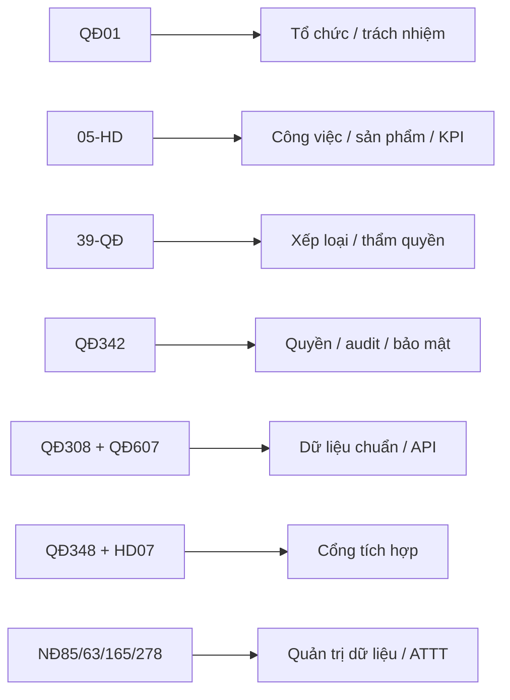

# 00 — Tổng quan hệ thống

## Mục tiêu

BTCTU là ứng dụng nội bộ quản lý thực hiện nhiệm vụ và quy trình KPI/đánh giá, đồng thời bảo toàn khả năng truy vết về nguồn nghiệp vụ.



## Trạng thái

- giao diện nghiệp vụ đã có đầy đủ luồng chính;
- REST API và OpenAPI đã có contract, validation, policy và error envelope;
- cấu hình local/staging/production tách biệt;
- dữ liệu local hiện do adapter tạm thời cung cấp trong lúc chờ API/kho dữ liệu hoàn chỉnh;
- typecheck, unit test, contract test, E2E và production build là cổng kiểm tra;
- các quy tắc chưa đủ căn cứ vẫn được đánh dấu chờ phê duyệt.

## Vấn đề còn mở

- JobPosition master chính thức;
- phiên bản danh mục công việc có hiệu lực;
- sai khác số học trong ví dụ 05-HD;
- công thức KPI cho người không giữ chức vụ;
- tổng hợp tháng → quý → năm;
- nhóm so sánh xếp loại Xuất sắc theo QĐ39;
- phân loại dữ liệu và cấp độ HTTT chính thức;
- phạm vi, endpoint và credential tích hợp thật.

## Hướng triển khai

```text
Phân tích nguồn
→ Truy vết
→ Mô hình nghiệp vụ
→ Thiết kế hệ thống
→ Triển khai ứng dụng
→ Nghiệm thu
→ Chuyển adapter API và hạ tầng được phê duyệt
```

Kiến trúc domain và API không phụ thuộc việc hạ tầng production cuối cùng là Cloudflare hay nền tảng khác được phê duyệt.
