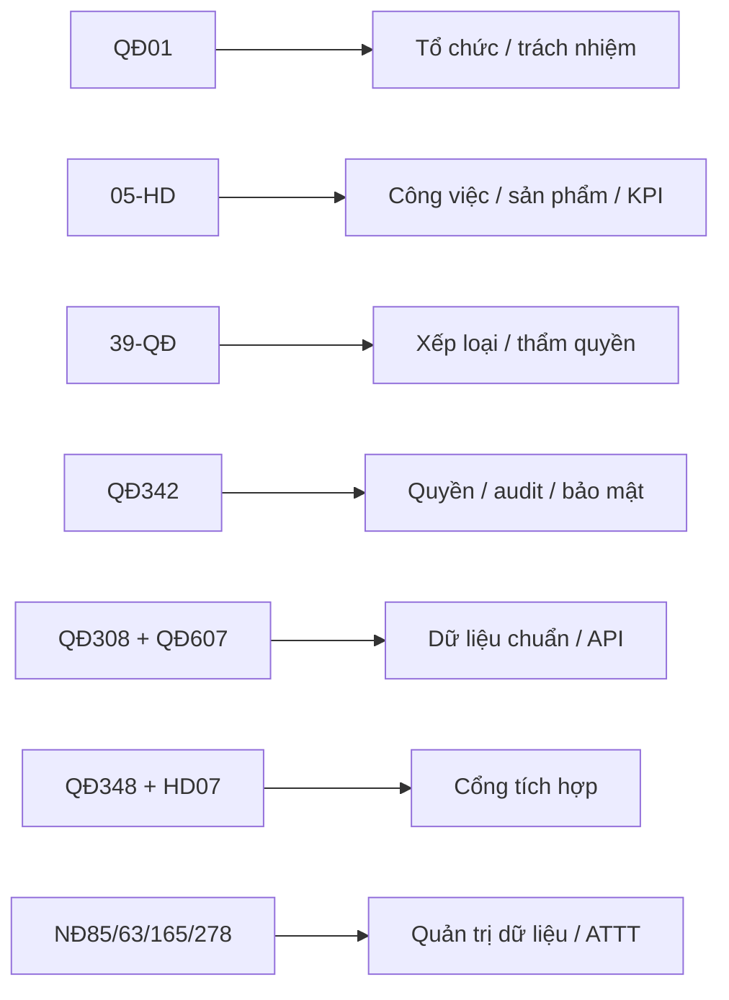

# 00 — Tổng quan hệ thống

## Mục tiêu

BTCTU là ứng dụng nội bộ quản lý thực hiện nhiệm vụ và quy trình KPI/đánh giá, đồng thời bảo toàn khả năng truy vết về nguồn nghiệp vụ.



## Trạng thái

Đây là bản thử nghiệm phát triển, chưa phải hệ thống sẵn sàng vận hành:

- giao diện đã mô phỏng các luồng chính nhưng vẫn xử lý dữ liệu trên trình duyệt;
- API đã có mô tả OpenAPI, kiểm tra đầu vào, đăng nhập và phân quyền;
- một số bảng PostgreSQL đã có, nhưng các tuyến nghiệp vụ vẫn chủ yếu dùng dữ liệu
  tạo lại theo từng yêu cầu;
- giao diện chưa gọi các tuyến API nghiệp vụ;
- kiểm tra kiểu dữ liệu, kiểm thử tự động và đóng gói là điều kiện tối thiểu khi
  ghép thay đổi;
- quy tắc chưa đủ căn cứ tiếp tục được đánh dấu chờ xác nhận, không được coi là
  quy định chính thức.

## Vấn đề còn mở

- JobPosition master chính thức;
- phiên bản danh mục công việc có hiệu lực;
- sai khác số học trong ví dụ 05-HD;
- công thức KPI cho người không giữ chức vụ;
- tổng hợp tháng → quý → năm;
- nhóm so sánh xếp loại Xuất sắc theo QĐ39;
- phân loại dữ liệu và cấp độ HTTT chính thức;
- phạm vi, endpoint và credential tích hợp thật.

## Hướng triển khai

```text
Phân tích nguồn
→ Truy vết
→ Mô hình nghiệp vụ
→ Thiết kế hệ thống
→ Triển khai ứng dụng
→ Nghiệm thu
→ Kết nối giao diện với API
→ Thay dữ liệu tạm bằng PostgreSQL
→ Kiểm thử tích hợp và xin phê duyệt vận hành
```

Hạ tầng vận hành cuối cùng chưa được quyết định trong repo này.
