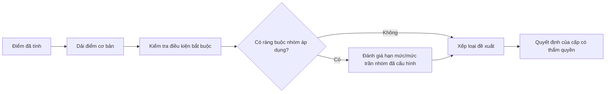

# Quy tắc xếp loại

## FACT — QĐ39

### Các dải điểm cơ bản

| Xếp loại | Dải điểm cơ bản |
|---|---:|
| Hoàn thành xuất sắc nhiệm vụ | >= 90 |
| Hoàn thành tốt nhiệm vụ | >= 70 và < 90 |
| Hoàn thành nhiệm vụ | >= 50 và < 70 |
| Không hoàn thành nhiệm vụ | < 50 hoặc có trường hợp chặn |

Nguồn: QĐ39, Điều 11.

## Chỉ điểm là chưa đủ

Mỗi mức xếp loại có thêm các điều kiện bắt buộc. Ví dụ gồm:

- tỷ lệ hoàn thành nhiệm vụ được giao;
- chất lượng/tiến độ;
- yêu cầu kết quả nổi trội cho mức Xuất sắc;
- điều kiện gắn với kết quả của đơn vị/lĩnh vực/cấp dưới đối với lãnh đạo;
- các trường hợp vi phạm/kỷ luật;
- hạn mức/mức trần Xuất sắc ở cấp nhóm **khi nhóm đối tượng và phạm vi so sánh
  khiến quy tắc đó áp dụng**.

Việc áp dụng hạn mức phải được xác định từ nhóm đối tượng và nhóm so sánh đã cấu
hình. Đây không phải bước phổ quát cho mọi đánh giá.

Vì vậy điều này là không hợp lệ:

```ts
if (score >= 90) return "EXCELLENT";
```

## Pipeline quyết định đề xuất [INFERENCE]



## Biểu diễn quy tắc ứng viên

```text
ClassificationRuleVersion
- version/effective period
- sourceRef
- subjectType
- scoreBands[]
- mandatoryConditions[]
- blockers[]
- groupQuotaRule?
- roundingPolicy
- status
```

Một evaluator tất định nhỏ là đủ cho tập quy tắc hiện tại. Không xây DSL/rules engine
tổng quát trừ khi tập quy tắc chứng minh là cần thiết.

`groupQuotaRule?` là tùy chọn. Việc thiếu nó nghĩa là đánh giá bỏ qua kiểm tra hạn
mức; không được hiểu là một hạn mức toàn cục ngầm định.

## TBD

- nhóm so sánh chính xác cho mức trần Xuất sắc trong BTCTU;
- ánh xạ chính xác từng nhóm đối tượng của QĐ39 sang vai trò trong ứng dụng;
- quy trình khiếu nại/mở lại/chỉnh sửa cục bộ sau khi công bố;
- quy tắc tổng hợp tháng→quý/năm chính thức cho hệ thống kiểm thử.
