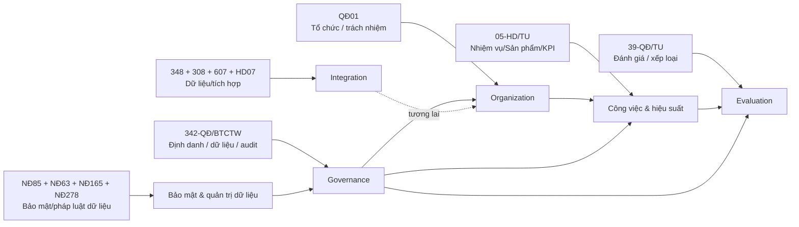

# Bản đồ domain nghiệp vụ và truy vết

## Bản đồ domain



## Năng lực nghiệp vụ cốt lõi

| Năng lực | Căn cứ nguồn | Trạng thái |
|---|---|---|
| Tổ chức / đơn vị / trách nhiệm | QĐ01 Điều 2–7 | Có căn cứ nguồn |
| Bối cảnh phân công vị trí/nhân sự | QĐ01 + Excel vận hành | Master vị trí vẫn cần xác nhận có thẩm quyền |
| Danh mục công việc/sản phẩm | 05-HD Phụ lục 1 + Excel draft + trường nhiệm vụ QĐ308 | Khái niệm có căn cứ nguồn; giá trị danh mục cần phê duyệt/phiên bản |
| Thực hiện/kết quả nhiệm vụ | Đo lường nhiệm vụ/sản phẩm của 05-HD | Cần mô hình phần mềm |
| KPI 30/70 và A/B/C/D cho lãnh đạo | 05-HD | Có căn cứ nguồn; ví dụ có sai khác số học |
| Tự đánh giá / thẩm định / quyết định cuối | 05-HD + QĐ39 | Các bước có căn cứ nguồn |
| Ngưỡng xếp loại + yếu tố chặn | QĐ39 Điều 11 | Có căn cứ nguồn |
| Đánh giá cá nhân + tập thể | Yêu cầu hệ thống + QĐ39 | Loại đối tượng có căn cứ nguồn; cách tính điểm tập thể vẫn cần cấu hình |
| Phân quyền/phạm vi dữ liệu/audit | QĐ342 | Ràng buộc có căn cứ nguồn |
| Từ điển canonical | QĐ308 | Có căn cứ nguồn |
| Contract API ngoài | QĐ607 | Tích hợp tương lai |
| Bảo mật/quy trình kết nối | QĐ348 + HD07 | Tích hợp tương lai / cổng production |
| Cấp độ bảo mật & dữ liệu được bảo vệ | NĐ85 + NĐ63 + QĐ342/348 | Quyết định production chính thức vẫn TBD |

## Mô hình tư duy trung tâm

```text
Organization
   ↓
Department
   ↓
Responsibility / Position
   ↓
WorkCatalogVersion
   ↓
Task / Assignment
   ↓
TaskResult / Product / EvidenceRef
   ↓
Chỉ số hiệu suất
   ↓
Evaluation (30 + 70)
   ↓
Điều kiện xếp loại
   ↓
Thẩm định / Quyết định cuối
   ↓
Khóa / Audit / Báo cáo
```

Các mũi tên sau `Responsibility` là **diễn giải phần mềm** dựng từ nhiều nguồn; chúng
không phải một sơ đồ quy trình đã tồn tại sẵn trong bất kỳ văn bản đơn lẻ nào.
