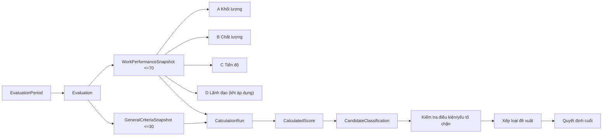

# Mô hình đánh giá / KPI

## FACT từ 05-HD/TU

### Cấu trúc điểm

```text
Tiêu chí chung                  tối đa 30
Kết quả thực hiện công việc     tối đa 70
------------------------------------
Tổng                            tối đa 100
```

Với lãnh đạo/quản lý, Phụ lục 2 trình bày:

```text
KPI = (A + B + C + D) / 4

A = Khối lượng
B = Chất lượng
C = Tiến độ
D = Lãnh đạo / chỉ đạo / tổ chức công việc
```

Phần trăm KPI được dùng để tính khối kết quả thực hiện công việc.

### Các bước đánh giá

05-HD/TU cũng nêu:

1. xác định mục tiêu/nhiệm vụ/sản phẩm;
2. tự chấm điểm/đánh giá/đề xuất xếp loại;
3. cấp có thẩm quyền trực tiếp thẩm định/đánh giá/đề xuất;
4. cấp có thẩm quyền quyết định;
5. thông báo/lưu kết quả.

## SOURCE INCONSISTENCY — sai khác số học trong ví dụ

Ví dụ cho:

- KPI = 82,3%;
- điểm chung = 30;
- rồi in `30 + (82,3% × 70) = 80,3`.

Số học cho **87,61**, không phải 80,3. Điều này xác định một sai khác trong ví dụ;
bản thân nó không chứng minh công thức chính thức là sai.

Cách xử lý của dự án:

- ghi nhận sai khác;
- không âm thầm “sửa luật/nguồn”;
- quy tắc chấm điểm vẫn theo phiên bản và cần xác nhận;
- thêm kiểm thử regression/đơn vị khi được phê duyệt.

## FACT từ QĐ39

Xếp loại cuối phụ thuộc vào **ngưỡng + điều kiện bắt buộc/yếu tố chặn**, không chỉ điểm.

Vì vậy mô hình phải tách phép tính khỏi quyết định xếp loại.

## Mô hình đề xuất [INFERENCE]



### Bất biến bắt buộc

- phép tính giữ đúng phiên bản quy tắc và snapshot đầu vào;
- tính lại tạo một lần chạy mới; không sửa lần chạy đã phê duyệt cũ;
- điểm tự đánh giá, điểm/đề xuất của người thẩm định và quyết định cuối là khác biệt;
- điều chỉnh thủ công cần lý do, người thực hiện, thẩm quyền và audit;
- kỳ đã chốt là bất biến, trừ khi qua quy trình mở lại rõ ràng.

## Cá nhân vs tập thể

Đề bài yêu cầu đánh giá cho cả cá nhân và đơn vị, trong khi QĐ39 bao quát đánh giá
tập thể và cá nhân. Từ hai đầu vào đó, `EvaluationSubject` là một abstraction phần
mềm đề xuất [INFERENCE] hỗ trợ:

- `PERSON`
- `DEPARTMENT`

Do đó `DEPARTMENT` là tên thực thể suy ra từ thiết kế, không phải thực thể được QĐ39
định nghĩa rõ ràng. Đánh giá đơn vị là một đối tượng riêng. **Không định nghĩa điểm
đơn vị bằng trung bình điểm nhân viên** trừ khi có quy tắc được phê duyệt yêu cầu rõ.

## Công thức cho công chức/không giữ chức vụ lãnh đạo — TBD

Ví dụ A/B/C/D rõ ràng của 05-HD hướng tới lãnh đạo/quản lý. Đề bài yêu cầu đánh giá
mọi công chức.

Hướng tiếp cận đề xuất:

- dùng `ScoringRuleVersion` riêng cho vị trí không giữ chức vụ lãnh đạo;
- suy ra từ làm rõ nghiệp vụ/danh mục đã được phê duyệt;
- không âm thầm bỏ D và lấy trung bình A/B/C rồi dán nhãn đó là FACT từ nguồn.

## Các kỳ

- quy trình quý được 05-HD làm căn cứ rõ ràng;
- xếp loại năm nằm trong QĐ39;
- bài kiểm tra yêu cầu tháng/quý/năm.

Điểm tháng có thể được thiết kế như một tầng đo lường vận hành cấp vào đánh giá quý,
nhưng cách tổng hợp chính thức của nó là **TBD/lựa chọn thiết kế**, không phải quy
tắc trực tiếp từ các nguồn này.
