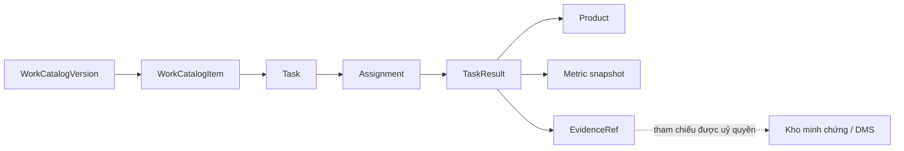

# Mô hình nhiệm vụ / sản phẩm / minh chứng

## Khái niệm có căn cứ nguồn

### FACT

Từ QĐ01:

- trưởng phòng / Chánh Văn phòng có trách nhiệm phân công công việc cụ thể gắn với
  vị trí việc làm cho thành viên.

Từ 05-HD/TU, đặc biệt Phụ lục 1:

- đánh giá dựa trên công việc được giao và sản phẩm đầu ra;
- một danh mục công việc/sản phẩm chuẩn có thể gồm đơn vị sản phẩm, điểm chuẩn, hệ
  số quy đổi, độ phức tạp/tác động và thời gian thực hiện.

Từ QĐ308:

- `MaNhiemVu` và `TenNhiemVu` là thành phần dữ liệu cốt lõi được chuẩn hóa.

Từ Excel vận hành:

- có một danh mục nháp thực tế với mã công việc, tên công việc, sản phẩm, độ phức
  tạp, thời hạn tối đa, điểm, hệ số quy đổi và giải thích;
- workbook này là **dữ liệu vận hành/nháp**, không tự động là quy tắc đã được phê duyệt.

## Mô hình domain đề xuất [INFERENCE]

### WorkCatalogVersion

Lưu một tập định nghĩa công việc đã công bố:

- phiên bản;
- khoảng hiệu lực;
- tham chiếu nguồn;
- phê duyệt/trạng thái;
- checksum/xuất xứ nhập.

### WorkCatalogItem

Các trường đề xuất:

- `code` — ánh xạ tới mã nhiệm vụ canonical khi áp dụng;
- `name`;
- `responsibilityId`;
- `expectedProduct`;
- `standardUnit`;
- `complexity`;
- `standardDuration`;
- `standardScore`;
- `conversionCoefficient`;
- `sourceRef`.

### Task

Một thực thể công việc thực tế. Nó **không** giống mục danh mục. Các trường đề xuất:

- định danh nhiệm vụ;
- mục/phiên bản danh mục được chọn;
- tiêu đề/mô tả;
- đơn vị sở hữu;
- kỳ;
- nguồn/xuất xứ;
- mốc thời gian tạo/phân công.

### Assignment

Tách công việc khỏi người nhận:

- nhiệm vụ;
- người nhận;
- người giao;
- vị trí/membership tại thời điểm giao;
- lịch sử phân công/phân công lại.

### TaskResult

- khối lượng thực tế;
- thời điểm hoàn thành;
- tham chiếu kết quả/sản phẩm;
- ghi chú;
- đầu vào đánh giá chất lượng;
- snapshot chỉ số dùng cho tính KPI.

## Minh chứng [INFERENCE]

Ứng dụng nên lưu **metadata/tham chiếu**, không đóng vai trò hệ thống quản lý tài
liệu bí mật nhà nước.

Đề xuất:
`EvidenceRef(id, type, uri/objectKey, checksum, classification, uploadedBy, createdAt)`.

Với phát triển và kiểm thử: chỉ dùng file/dữ liệu không nhạy cảm có kiểm soát.

## Mô hình trạng thái [INFERENCE, không phải thuật ngữ nguồn]

Một ứng dụng tối thiểu có thể dùng các trạng thái như:

`DRAFT → ASSIGNED → IN_PROGRESS → SUBMITTED → ACCEPTED/CLOSED`

nhưng các nhãn/chuyển đổi này là thiết kế sản phẩm và không được trình bày như quy
tắc từ 05-HD/QĐ01.

## Hạng mục còn mở

- danh sách vị trí có thẩm quyền;
- phê duyệt/phiên bản chính thức của danh mục Excel;
- quy tắc nghiệm thu/trả lại chính xác theo từng sản phẩm;
- cách xử lý chính thức với nhiệm vụ phát sinh;
- có được lưu nội dung minh chứng hay chỉ tham chiếu trong production.
