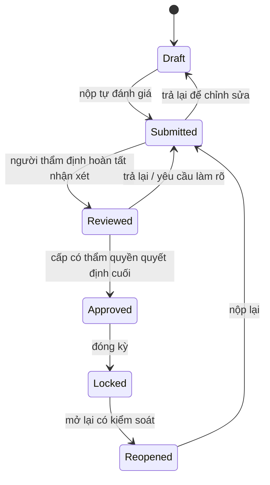

# Quy trình đánh giá

## Các bước suy ra từ nguồn

Từ 05-HD/TU + QĐ39:


Các bước này là **FACT ở mức khái niệm**.

## Máy trạng thái ứng dụng [INFERENCE]

Ứng dụng có thể triển khai các bước đó bằng:



Các tên trạng thái (giữ tiếng Anh) và chuyển đổi cụ thể ở trên là thiết kế phần
mềm, không phải thuật ngữ sao chép từ văn bản quy phạm.

## Xác định thẩm quyền

Không hard-code:

```text
MANAGER -> approve all employees
```

Thay vào đó, xác định:

```text
đối tượng
+ tổ chức / vị trí
+ kỳ đánh giá
+ quan hệ thẩm quyền
+ phạm vi dữ liệu
→ người thẩm định / cấp quyết định cuối
```

QĐ39 quy định các cấp có thẩm quyền khác nhau cho các nhóm đối tượng khác nhau.

## Khóa/mở lại [INFERENCE]

Sau quyết định cuối, snapshot/phiên bản quy tắc/kết quả nên được khóa. Nếu cho phép
chỉnh sửa:

- tạo yêu cầu mở lại;
- ghi lý do và thẩm quyền;
- giữ nguyên quyết định/lần tính trước;
- tạo phiên bản được thẩm định/quyết định mới;
- vết audit đầy đủ.

Sự tồn tại/chi tiết của quy trình mở lại nội bộ vẫn là TBD; đây là hành vi sản phẩm
an toàn nhất để bảo toàn khả năng truy vết.

## Tháng / quý / năm

- **Quý:** quy trình chính thức có căn cứ nguồn từ 05-HD.
- **Năm:** QĐ39 dùng kết quả lũy kế/định kỳ làm đầu vào cho xếp loại năm.
- **Tháng:** được đề bài yêu cầu, nhưng quy trình/aggregation pháp lý chính xác chưa
  được quy định đầy đủ trong các nguồn đã rà soát.

Thiết kế ứng viên: tháng = bản chụp hiệu suất vận hành; quý/năm = kỳ đánh giá chính
thức với quy tắc theo phiên bản.
