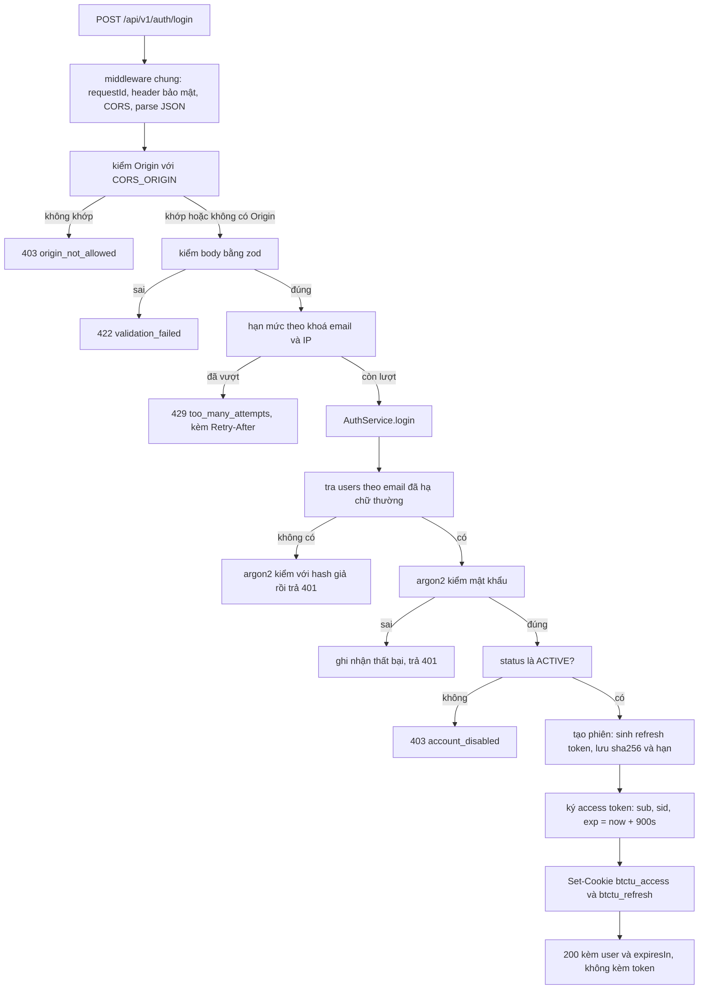
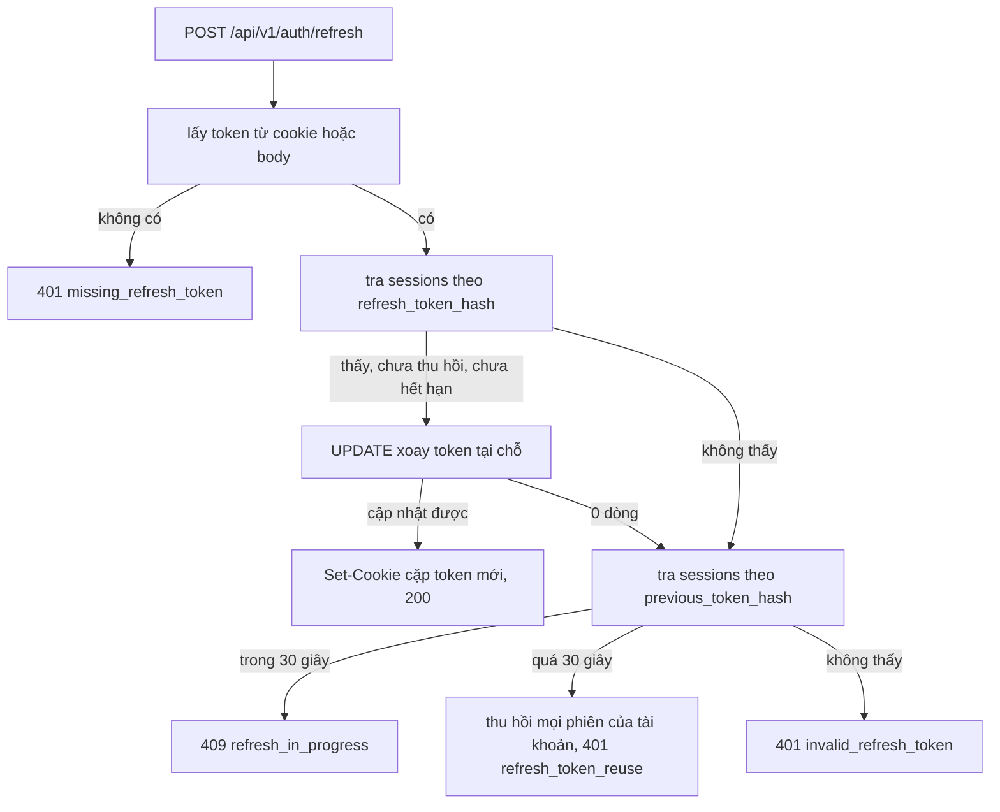

# Hợp đồng API đăng nhập

Trạng thái: đã hiện thực trong `apps/api`, kèm migration `0002`. Đây là thiết kế
cục bộ; việc gắn tài khoản với danh mục nhân sự và vai trò còn để lại (xem mục
Giới hạn).

## Phạm vi

API xác thực bằng email và mật khẩu, trả cả access token lẫn refresh token trong
cookie `HttpOnly`. JavaScript trong trình duyệt không đọc được token nào, nên
không có chỗ nào trong ứng dụng web phải giữ token.

Từ bản này, danh tính khi chạy production lấy từ access token do chính API cấp.
Header `x-dev-user-id` chỉ còn hiệu lực khi `ENVIRONMENT` khác `production`.

Cả bốn endpoint nằm dưới `/api/v1/auth`:

| Method | Path | Việc | Cần access token |
|---|---|---|---|
| POST | `/api/v1/auth/login` | đổi email và mật khẩu lấy token | không |
| POST | `/api/v1/auth/refresh` | xoay refresh token, cấp access token mới | không, dùng cookie hoặc body |
| POST | `/api/v1/auth/logout` | thu hồi phiên hiện tại | không |
| GET | `/api/v1/auth/session` | trả tài khoản và phiên của access token | có, cookie hoặc Bearer |

## Thành phần

Đường dẫn tính từ `apps/api/src`.

| File | Vai trò |
|---|---|
| `modules/auth/auth.routes.ts` | bốn route, ghi/xoá cookie, ánh xạ lỗi sang HTTP |
| `modules/auth/auth.service.ts` | xác minh mật khẩu, cấp phiên, xác minh access token |
| `modules/auth/session.service.ts` | cấp phiên, xoay token tại chỗ, phát hiện dùng lại |
| `modules/auth/token.service.ts` | ký và kiểm JWT, sinh và băm refresh token |
| `modules/auth/password.service.ts` | băm và kiểm mật khẩu bằng argon2id |
| `modules/auth/repositories/user.repository.ts` | đọc và tạo bản ghi `users` |
| `modules/auth/repositories/session.repository.ts` | tạo, tra, xoay và thu hồi `sessions` |
| `modules/auth/auth.module.ts` | ghép nối từ biến môi trường, mở pool ở request đầu tiên |
| `modules/auth/auth.types.ts` | cổng `AuthPort`, `SessionStore` và các lỗi miền |
| `middleware/authentication.ts` | guard Bearer/cookie cho route cần token |
| `middleware/csrf.ts`, `security/origin.ts` | kiểm `Origin` cho request đổi trạng thái |
| `security/cookie.ts` | tên cookie, ghi và đọc cookie, không phụ thuộc thư viện ngoài |
| `security/throttle.ts` | hạn mức số lần đăng nhập sai |
| `shared/problem.ts` | khuôn lỗi problem+json dùng chung với các route khác |

## Cấu hình

`readEnv` kiểm tra cấu hình lúc khởi động và dừng ngay nếu sai, thay vì chạy với
giá trị `NaN` hay chuỗi rỗng.

| Biến | Mặc định | Ràng buộc |
|---|---|---|
| `DATABASE_URL` | bắt buộc | phải bắt đầu bằng `postgres://` hoặc `postgresql://` |
| `JWT_ACCESS_SECRET` | bắt buộc | từ 16 ký tự; từ 32 ký tự khi `ENVIRONMENT=production` |
| `JWT_ACCESS_ISSUER` | `btctu-api` | |
| `JWT_ACCESS_AUDIENCE` | `btctu-web` | |
| `JWT_ACCESS_TTL_SECONDS` | 900 | số nguyên 60..86400 |
| `REFRESH_TOKEN_TTL_SECONDS` | 604800 | số nguyên 300..31536000 và lớn hơn `JWT_ACCESS_TTL_SECONDS` |
| `CORS_ORIGIN` | `http://localhost:3000` | URL tuyệt đối, scheme `http`/`https` |
| `PORT` | 8787 | số nguyên 1..65535 |
| `ENVIRONMENT` | `local` | đặt `production` để bật cờ `Secure` và tắt header phát triển |

## Cookie

| Cookie | Nội dung | Path | Max-Age | Cờ |
|---|---|---|---|---|
| `btctu_access` | JWT access token | `/api/v1` | `JWT_ACCESS_TTL_SECONDS` | `HttpOnly`, `SameSite=Strict` |
| `btctu_refresh` | refresh token thô | `/api/v1/auth` | `REFRESH_TOKEN_TTL_SECONDS` | `HttpOnly`, `SameSite=Strict` |

Cả hai đặt `Secure` khi `ENVIRONMENT=production`. Access token đi kèm mọi route
`/api/v1` vì guard đọc nó; refresh token chỉ đi tới các endpoint auth.

Access token có các claim: `sub` là id tài khoản, `sid` là id phiên, `iss`,
`aud`, `iat`, `exp`; header dùng `alg: HS256`, `typ: JWT`. Refresh token là
chuỗi ngẫu nhiên 32 byte mã hoá base64url; cơ sở dữ liệu chỉ lưu `sha256`.

Vì token nằm trong cookie, ứng dụng web gọi API bằng `fetch` với
`credentials: "include"` và API trả `access-control-allow-credentials: true` cho
đúng `CORS_ORIGIN`. `SameSite=Strict` phù hợp khi web và API cùng site; nếu triển
khai tách site thật thì phải đổi sang `SameSite=None; Secure` và thêm CSRF token
riêng — chưa làm vì chưa chốt hạ tầng. [TBD]

## POST /api/v1/auth/login

Request:

```json
{
  "email": "staff@btctu.local",
  "password": "dev-only-changeme"
}
```

`email` từ 3 tới 255 ký tự, đúng dạng email, được hạ chữ thường trước khi tra cứu;
`password` từ 8 tới 200 ký tự.

Response 200:

```json
{
  "data": {
    "user": {
      "id": "5f0d8f7e-6a1b-4d1e-9d6a-2e4a1c9b7f30",
      "email": "staff@btctu.local",
      "status": "ACTIVE"
    },
    "expiresIn": 900
  },
  "meta": {
    "tokenStorage": "httpOnly-cookie",
    "accessTokenCookie": "btctu_access",
    "refreshTokenCookie": "btctu_refresh"
  }
}
```

Body không chứa token. Client biết phiên còn sống hay không bằng cách gọi
`GET /api/v1/auth/session`, hoặc chờ lần gọi API kế tiếp trả 401.

## Phiên và vòng xoay token

Mỗi lần đăng nhập tạo một dòng trong `sessions`. Refresh **không** tạo dòng mới:
token được xoay tại chỗ trên cùng dòng, nên `session.id` giữ nguyên suốt một chuỗi
đăng nhập. Cụ thể khi refresh:

1. `refresh_token_hash` nhận hash của token mới;
2. hash của token vừa dùng chuyển sang `previous_token_hash`;
3. `last_used_at` cập nhật theo thời điểm xoay.

Bước xoay là một câu `UPDATE ... WHERE id = $1 AND refresh_token_hash = $2 AND
revoked_at IS NULL`. Điều kiện trong `WHERE` khiến việc xoay có tính nguyên tử:
hai request refresh cùng lúc với cùng một token thì chỉ một request cập nhật được
dòng, request kia biết mình đã thua.

Request thua cuộc được phân loại theo thời gian:

| Tình huống | Kết quả |
|---|---|
| Token vừa bị xoay trong vòng 30 giây | 409 `refresh_in_progress`, không thu hồi gì; client thử lại và trình duyệt đã có cookie mới |
| Token cũ xuất hiện lại sau 30 giây | coi là token bị lộ, thu hồi mọi phiên của tài khoản, trả 401 `refresh_token_reuse` |

Cửa sổ 30 giây là hằng số `ROTATION_GRACE_SECONDS`. Nó đánh đổi: trong 30 giây đầu,
việc dùng lại token cũ không kích hoạt thu hồi, bù lại hai tab refresh đồng thời
không còn đá toàn bộ phiên của người dùng ra ngoài.

Mọi request có access token đều kiểm phiên trong cơ sở dữ liệu: chữ ký và hạn
chưa đủ, phiên phải còn tồn tại, chưa bị thu hồi và chưa hết hạn. Nhờ vậy đăng xuất
hoặc thu hồi phiên có hiệu lực ngay với access token, đổi lại mỗi request tốn thêm
một truy vấn `sessions`.

| Trạng thái phiên tra theo hash | Kết quả của `refresh` |
|---|---|
| Không tìm thấy ở cả hai cột hash | 401 `invalid_refresh_token` |
| Đã quá `expires_at` | 401 `invalid_refresh_token` |
| Đã có `revoked_at` (ví dụ sau đăng xuất) | 401 `invalid_refresh_token` |
| Còn hiệu lực | xoay token tại chỗ, trả 200 |
| Tài khoản đã bị khoá hoặc đã xoá | 403 `account_disabled` hoặc 401, mọi phiên bị thu hồi |

## POST /api/v1/auth/refresh

Không cần body nếu trình duyệt đã có cookie. Client không dùng cookie thì gửi
`{ "refreshToken": "..." }` trong body. Response 200 có cùng khuôn với login và
kèm `Set-Cookie` cho cả hai token; lỗi 409 dùng cho trường hợp hai request refresh
chồng lên nhau, client nên thử lại chứ không đăng xuất.

## POST /api/v1/auth/logout

Xoá cả hai cookie, thu hồi phiên tìm theo refresh token, trả 204 và không có body.
Không tìm thấy token thì vẫn trả 204. Access token cũ mất hiệu lực ngay vì phiên
đã bị thu hồi.

## GET /api/v1/auth/session

Đọc access token từ cookie `btctu_access` hoặc từ header
`Authorization: Bearer <accessToken>`.

Response 200:

```json
{
  "data": {
    "user": {
      "id": "5f0d8f7e-6a1b-4d1e-9d6a-2e4a1c9b7f30",
      "email": "staff@btctu.local",
      "status": "ACTIVE"
    },
    "session": { "id": "b1a6c2d3-4e5f-4a7b-8c9d-0e1f2a3b4c5d" }
  },
  "meta": { "identityMode": "access-token" }
}
```

Tài khoản không còn `ACTIVE` trả 401 `inactive_account`.

## Mã lỗi

Mọi lỗi trả về cùng khuôn problem+json như các route khác:

```json
{
  "type": "https://btctu.local/problems/invalid_credentials",
  "title": "Unauthorized",
  "status": 401,
  "detail": "Email or password is incorrect.",
  "instance": "/login",
  "requestId": "d8f79b18-e1fa-4062-b922-c4969f945206"
}
```

| HTTP | `type` (phần cuối) | Khi nào |
|---|---|---|
| 422 | `validation_failed` | body sai hợp đồng, `detail` liệt kê từng field |
| 401 | `invalid_credentials` | sai mật khẩu hoặc không có tài khoản, dùng chung một thông báo |
| 403 | `account_disabled` | mật khẩu đúng nhưng `status` là `DISABLED` |
| 429 | `too_many_attempts` | quá số lần sai cho phép, kèm header `Retry-After` |
| 409 | `refresh_in_progress` | request refresh thứ hai trong cửa sổ 30 giây |
| 403 | `origin_not_allowed` | request đổi trạng thái có `Origin` khác `CORS_ORIGIN` |
| 401 | `missing_access_token` | route cần token nhưng không có cookie lẫn header |
| 401 | `invalid_access_token` | token sai chữ ký, sai issuer/audience, hết hạn hoặc phiên đã bị thu hồi |
| 401 | `inactive_account` | token hợp lệ nhưng tài khoản không còn `ACTIVE` |
| 403 | `actor_not_provisioned` | production: tài khoản chưa gắn với nhân sự trong danh mục |
| 401 | `missing_refresh_token` | không có cookie và body rỗng |
| 401 | `invalid_refresh_token` | refresh token không tồn tại, đã hết hạn hoặc đã bị thu hồi |
| 401 | `refresh_token_reuse` | token cũ quay lại sau cửa sổ 30 giây |
| 500 | `internal_error` | lỗi ngoài dự kiến, ví dụ không kết nối được cơ sở dữ liệu |

## Luồng đăng nhập



Nhánh sai Origin, sai body và vượt hạn mức xảy ra trước khi chạm cơ sở dữ liệu. Khi
email không tồn tại, hệ thống vẫn chạy một phép argon2 để thời gian phản hồi tương
đương trường hợp sai mật khẩu.

## Luồng xoay token



## Quy tắc đang áp dụng

| Quy tắc | Cách làm |
|---|---|
| Mật khẩu không lưu dạng thô | argon2id, tham số mặc định của thư viện |
| Không lộ tài khoản nào đã đăng ký | sai mật khẩu và không có tài khoản trả cùng 401, có bù thời gian |
| Token không lưu dạng thô | cơ sở dữ liệu giữ `sha256` của refresh token |
| JavaScript không đọc được token | cả hai token là cookie `HttpOnly` |
| Thu hồi phiên có hiệu lực ngay | mỗi request có token đều kiểm phiên trong `sessions` |
| Token bị lộ thì mất hiệu lực | xoay token mỗi lần refresh; token cũ quay lại sau cửa sổ ân hạn thì thu hồi cả họ phiên |
| Hai tab refresh cùng lúc không đá nhau | xoay nguyên tử, request thua nhận 409 để thử lại |
| Chặn dò mật khẩu | 10 lần sai trong 60 giây cho mỗi cặp email và IP |
| Chặn gọi chéo từ site khác | kiểm `Origin` cho mọi request đổi trạng thái dưới `/api/v1`, token trong cookie đều `SameSite=Strict` |
| Route cần token thì mặc định từ chối | guard trả 401 trước khi vào handler |
| Production không nhận danh tính từ header | `x-dev-user-id` chỉ dùng khi `ENVIRONMENT` khác `production` |
| Ghi vết | mỗi lần đăng nhập, làm mới, đăng xuất, phát hiện dùng lại đều phát một dòng log có `scope: auth` |

Không ghi mật khẩu, access token hoặc refresh token vào log.

## Chạy và kiểm thử

```bash
pnpm --filter @btctu/api db:migrate
pnpm --filter @btctu/api db:seed
pnpm --filter @btctu/api dev
```

`db:migrate` cần chạy migration `0002` để có cột `previous_token_hash`.
`db:seed` tạo ba tài khoản `leader@btctu.local`, `head@btctu.local`,
`staff@btctu.local` với mật khẩu `dev-only-changeme`, đổi bằng biến
`DEV_SEED_PASSWORD`.

```bash
curl -i -c cookies.txt -X POST http://localhost:8787/api/v1/auth/login \
  -H "content-type: application/json" \
  -d '{"email":"staff@btctu.local","password":"dev-only-changeme"}'

curl -b cookies.txt http://localhost:8787/api/v1/auth/session
```

Kiểm thử tự động: `pnpm --filter @btctu/api test`. Bộ test HTTP của luồng này nằm
ở `modules/auth/auth.routes.test.ts` (gồm cả nhánh 409 và thu hồi khi token cũ
quay lại), phần vòng xoay và cửa sổ ân hạn nằm ở `session.service.test.ts`, còn
`env.test.ts` kiểm các ràng buộc cấu hình. Tất cả chạy với kho in-memory nên không
cần PostgreSQL.

## Giới hạn còn lại

- Bảng `users` chưa có vai trò và đơn vị, nên ở production tài khoản đăng nhập
  được nhưng chưa thành actor của các route nhiệm vụ: API trả 403
  `actor_not_provisioned`. Việc gắn tài khoản với danh mục nhân sự thuộc mốc P2. [TBD]
- Chỉ hash của token ngay trước được lưu. Token cũ hơn nữa quay lại sẽ bị coi là
  token lạ và trả 401, không kích hoạt thu hồi họ phiên. Muốn đủ thì cần token
  family hoặc bảng lịch sử xoay. [TBD]
- Kiểm phiên ở mỗi request thêm một truy vấn `sessions`; khi tải cao nên cache
  ngắn hạn hoặc chọn chỉ kiểm ở các thao tác nhạy cảm. [TBD]
- Cửa sổ ân hạn 30 giây là hằng số trong mã, chưa cấu hình theo môi trường.
- Hạn mức đăng nhập sai nằm trong bộ nhớ tiến trình. Chạy nhiều instance thì cần
  kho chia sẻ. [TBD]
- Chưa có MFA cho tài khoản đặc quyền, trong khi QĐ342 yêu cầu khi lên production. [TBD]
- `SameSite=Strict` chỉ đúng khi web và API cùng site. [TBD]
- Web app hiện dùng dữ liệu mock, chưa gọi các endpoint này.
- `instance` trong phản hồi lỗi đang là path tương đối so với router được mount,
  ví dụ `/login`; riêng lỗi 500 của handler toàn cục dùng path đầy đủ. Cần thống
  nhất trước khi chốt hợp đồng. [TBD]
- Chưa chạy `db:migrate` và `db:seed` trên PostgreSQL thật trong môi trường phát
  triển hiện tại, nên phần truy vấn chỉ được kiểm chứng ở mức sinh đúng câu SQL.
