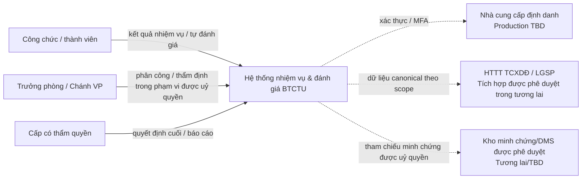
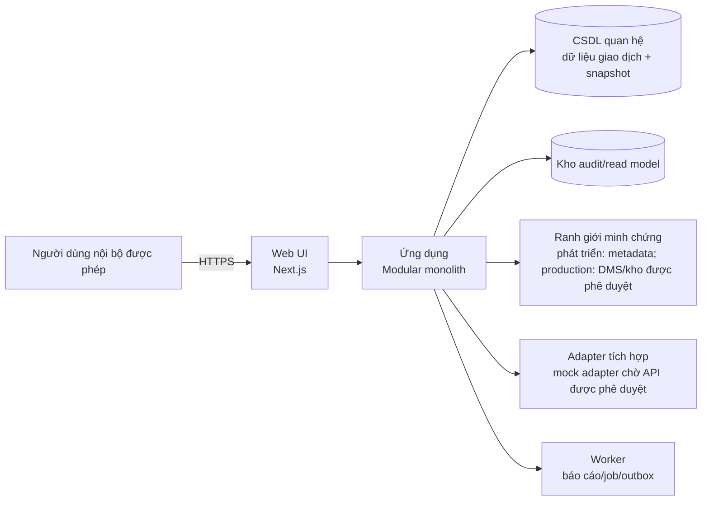

# Bối cảnh hệ thống và container

## Bối cảnh [INFERENCE dựa trên vai trò trong nguồn]

## Container ứng dụng [đề xuất]

## Ghi chú ranh giới

- “Trưởng phòng” không tự động đồng nghĩa người phê duyệt cuối; thẩm quyền được xác
  định theo quy tắc nguồn.
- Tài liệu bí mật nhà nước nằm ngoài ranh giới ứng dụng.
- Tích hợp ngoài thật bị tắt cho tới khi đạt các cổng production.
- Việc tách container là thiết kế kỹ thuật; QĐ342 cung cấp ràng buộc kiến trúc/bảo
  mật, không phải các thành phần triển khai chính xác này.
