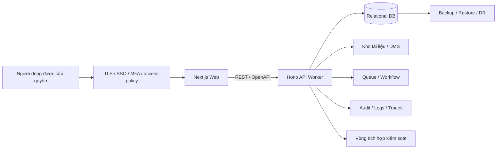

# Kiến trúc triển khai

## Mô hình

Web và API là hai đơn vị triển khai độc lập. Backend giữ cấu trúc modular monolith để giao dịch, phân quyền và audit nhất quán.

## Môi trường

| Môi trường | Dữ liệu | Danh tính | Mục đích |
|---|---|---|---|
| Local | dữ liệu khởi tạo cục bộ | adapter `x-dev-user-id` | phát triển và unit/contract test |
| Staging | dữ liệu tổng hợp hoặc đã che theo phê duyệt | Access/IdP staging | tích hợp, E2E, UAT |
| Production | dữ liệu thật sau phê duyệt | Access/IdP production | vận hành chính thức |

Không dùng chung database, bucket, secret, audience hoặc Access policy giữa các môi trường.

## Cổng production

- phê duyệt cấp độ HTTT và phân loại dữ liệu;
- xác minh Access JWT đầy đủ signature, issuer và audience;
- repository bền vững, migration có rollback, backup/restore đã diễn tập;
- kho tài liệu/DMS và retention được phê duyệt;
- quyền theo action + resource + scope + context ở server;
- giới hạn tần suất, giới hạn kích thước yêu cầu, CSP, allowlist CORS;
- giám sát, cảnh báo, runbook sự cố và RPO/RTO;
- security test và operational sign-off;
- endpoint, scope, network route và credential cho LGSP/HTTT TCXDĐ.

Cloudflare là lựa chọn triển khai hiện tại cho API, nhưng domain/application contract vẫn có thể chuyển sang hạ tầng được phê duyệt khác.
