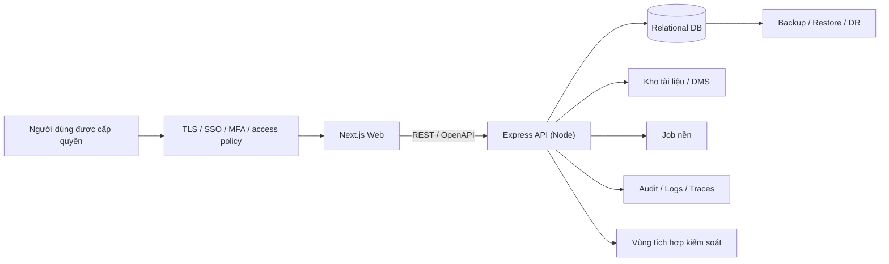

# Kiến trúc triển khai

## Mô hình

Web và API là hai đơn vị triển khai độc lập. Backend giữ cấu trúc modular monolith để giao dịch, phân quyền và audit nhất quán.

## Môi trường

| Môi trường | Dữ liệu                                     | Danh tính                   | Mục đích                         |
| ---------- | ------------------------------------------- | --------------------------- | -------------------------------- |
| Local      | dữ liệu khởi tạo cục bộ                     | adapter `x-dev-user-id`     | phát triển và unit/contract test |
| Staging    | dữ liệu tổng hợp hoặc đã che theo phê duyệt | IdP/access token staging    | tích hợp, E2E, UAT               |
| Production | dữ liệu thật sau phê duyệt                  | IdP/access token production | vận hành chính thức              |

Không dùng chung database, bucket, secret, audience hoặc policy truy cập giữa các môi trường.

## Cổng production

- phê duyệt cấp độ HTTT và phân loại dữ liệu;
- xác minh access token đầy đủ signature, issuer và audience;
- repository bền vững, migration có rollback, backup/restore đã diễn tập;
- kho tài liệu/DMS và retention được phê duyệt;
- quyền theo action + resource + scope + context ở server;
- giới hạn tần suất, giới hạn kích thước yêu cầu, CSP, allowlist CORS;
- giám sát, cảnh báo, runbook sự cố và RPO/RTO;
- security test và operational sign-off;
- endpoint, scope, network route và credential cho LGSP/HTTT TCXDĐ.

API là Express trên Node sau reverse proxy; domain/application contract vẫn có thể chạy trên hạ tầng được phê duyệt khác.

## Kỷ luật migration

Tệp migration đã publish là bất biến: không sửa lại tệp đã từng chạy ở bất kỳ môi
trường nào, vì Drizzle coi tệp đó đã được áp dụng và sẽ không chạy lại phần vừa
thêm vào. Mọi thay đổi schema là một tệp mới, và tệp mới phải chạy được trên cả cơ
sở dữ liệu mới lẫn cơ sở dữ liệu đã ở trạng thái trước đó — ví dụ
`DROP CONSTRAINT IF EXISTS` rồi `ADD CONSTRAINT` thay vì chỉ `ADD CONSTRAINT`.

Trường hợp đã xảy ra: `0003_smooth_zaladane.sql` được bổ sung ràng buộc
`audit_events_outcome_check` sau khi đã publish, nên một cơ sở dữ liệu chạy bản
`0003` cũ không có ràng buộc đó trong khi cơ sở dữ liệu mới thì có.
`0004_audit_outcome_check.sql` khắc phục mà không đụng lại `0003`.
