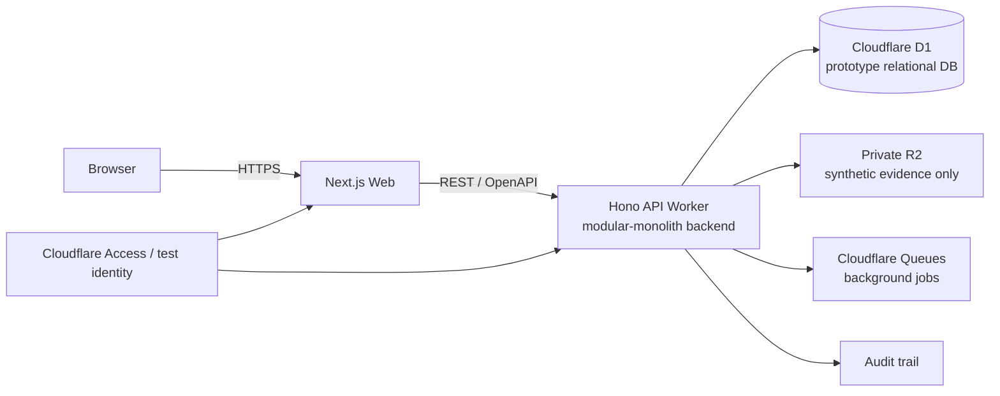
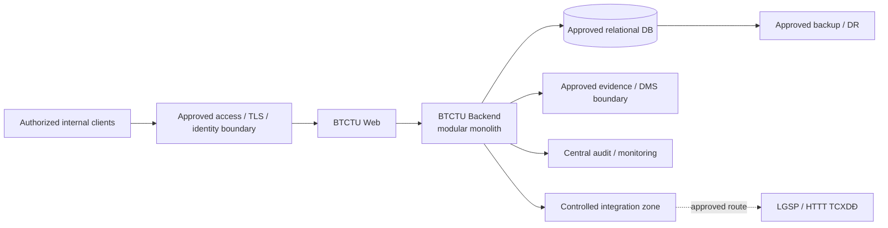

# Deployment architecture — prototype and production target

## Decision [INFERENCE]

The competency-test prototype is an **internal web application with a separate
web frontend and a modular-monolith backend API**.

This is an engineering choice for the test, not a requirement stated by the
regulations.

## Prototype / demo target

Current candidate stack:

Prototype constraints:

- synthetic/demo data only;
- no real LGSP/TCXDĐ connection;
- no real personnel, BVCTNB, health or state-secret content;
- Cloudflare is a **prototype deployment choice**, not a claim that the final
  production system is approved to run there.

## Production target — platform TBD

At production-design level the architecture requirement is platform-neutral:

Possible implementation paths after approval may include Cloudflare-based
components or an approved self-hosted/cloud infrastructure. The application/domain
design must not depend on Cloudflare being accepted for production.

## Production gates

Before selecting the final hosting stack:

- formal HTTT level assessment/approval;
- data inventory and classification;
- approved network/hardware/cloud location;
- state-secret handling boundary;
- identity/MFA and privileged-access design;
- database backup/restore, RPO/RTO and DR requirements;
- evidence/document-storage approval;
- LGSP/TCXDĐ integration purpose, scope, network and credentials;
- security testing and operational approval.

Until those gates are resolved, any production platform diagram is a **target
architecture**, not an assertion of legal/security approval.
