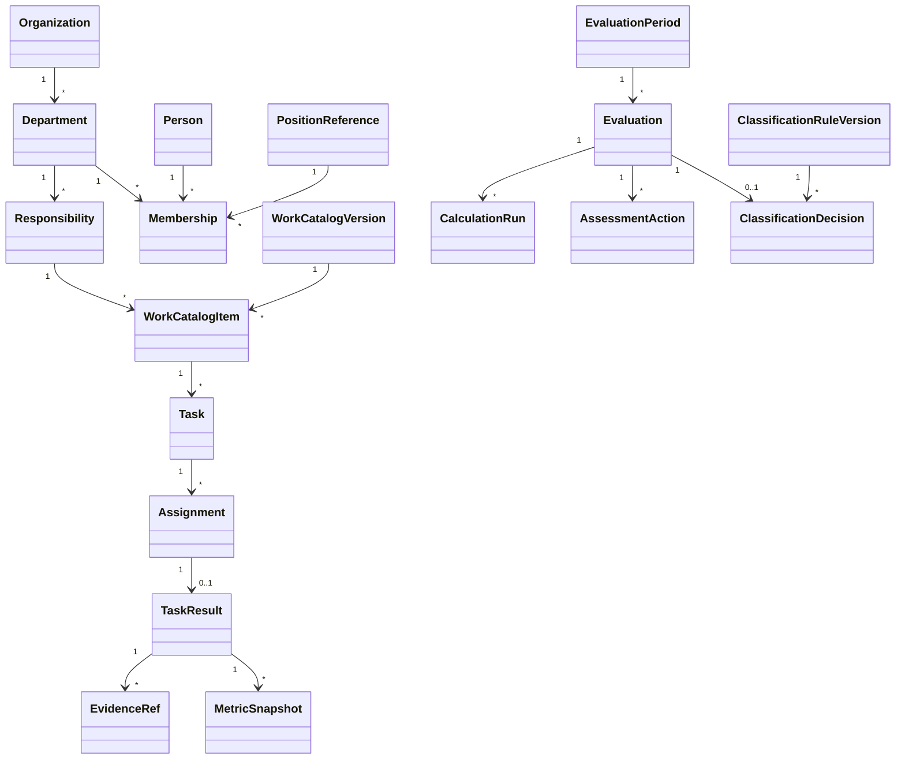

# Mô hình domain

## Aggregate [INFERENCE]

## Ranh giới aggregate

### Tổ chức
Sở hữu cơ cấu tổ chức/tham chiếu membership. Master nhân sự cuối cùng có thể là một
projection từ dữ liệu cán bộ chủ quản.

### Danh mục công việc (Work Catalog)
Định nghĩa theo phiên bản cho công việc/sản phẩm/đo lường chuẩn. Công bố danh mục
mới không bao giờ thay đổi các nhiệm vụ lịch sử.

### Task
Sở hữu một thực thể nhiệm vụ cụ thể, phân công và snapshot kết quả. Phân công lại
vẫn giữ lịch sử.

### Evaluation
Sở hữu một đánh giá theo đối tượng+kỳ, các lần tính, lịch sử tự đánh giá/thẩm
định/quyết định cuối và trạng thái khóa.

### Quy tắc xếp loại
Ngưỡng/điều kiện/yếu tố chặn theo phiên bản. Được Evaluation tham chiếu thay vì
nhúng thành hằng số chỉ-trong-code có thể thay đổi.

### Audit
Kho sự kiện/read model append-only xuyên suốt. Hành động của module nghiệp vụ phát
sinh bản ghi audit qua một service duy nhất.

## Bất biến domain

- không có xếp loại cuối nếu thiếu quyết định của cấp có thẩm quyền;
- không ghi đè lần tính/quyết định đã phê duyệt;
- phiên bản quy tắc/danh mục là bất biến một khi đã được bản ghi đã phê duyệt dùng;
- chỉ ngưỡng điểm không thể bỏ qua điều kiện bắt buộc của QĐ39;
- quyền admin kỹ thuật không đồng nghĩa thẩm quyền đánh giá;
- dữ liệu ngoài không thể âm thầm trở thành dữ liệu chủ quản cục bộ.
