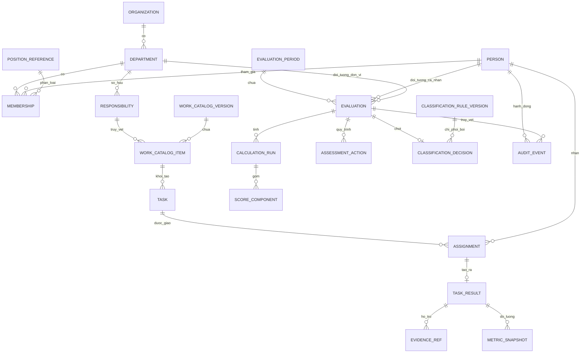

# Mô hình dữ liệu logic (ERD)

> Tên thực thể dưới đây là **thiết kế phần mềm**. Sự tồn tại của chúng truy vết
> được về khái niệm trong nguồn, nhưng bản thân cấu trúc bảng không do văn bản quy
> phạm quy định.

## Ánh xạ nguồn → thực thể

| Thực thể                                   | Vì sao tồn tại                                                      |
| ------------------------------------------ | ------------------------------------------------------------------- |
| Organization / Department / Responsibility | QĐ01                                                                |
| Person / Membership / PositionReference    | QĐ01 có nhắc tổ chức/thành viên/vị trí; master chủ quản vẫn TBD     |
| WorkCatalogVersion / Item                  | 05-HD PL1 + danh mục công việc vận hành                             |
| Task / Assignment / Result                 | phân công theo QĐ01 + khái niệm nhiệm vụ/sản phẩm/kết quả của 05-HD |
| MetricSnapshot                             | đo lường A/B/C/D của 05-HD                                          |
| EvaluationPeriod / Evaluation              | đề bài + 05-HD/QĐ39                                                 |
| CalculationRun / ScoreComponent            | phép tính 30/70 phải tái lập được/theo phiên bản                    |
| ClassificationRuleVersion / Decision       | ngưỡng + điều kiện của QĐ39                                         |
| AssessmentAction                           | các bước của QĐ39/05                                                |
| AuditEvent                                 | yêu cầu truy vết của QĐ342                                          |

Mốc ORG-001 hiện thực bốn thực thể đầu thành bảng `departments`, `people`,
`positions` và `position_assignments` (migration `0005_org_core.sql`); phần tên
trường và căn cứ từng trường nằm ở
[organization-fields.md](../03-business/organization-fields.md).

## Quy tắc mô hình hóa quan trọng

- `Evaluation.subjectType` là `PERSON` hoặc `DEPARTMENT`; chỉ đúng một tham chiếu đối tượng được áp dụng.
- Đánh giá đã phê duyệt giữ đúng các phiên bản danh mục/quy tắc/đầu vào đã dùng.
- Tính lại sẽ thêm một `CalculationRun` mới; không viết lại lịch sử.
- Dữ liệu nhân sự/tổ chức từ ngoài giữ định danh/ánh xạ hệ thống nguồn.
- `EvidenceRef` chỉ là metadata/tham chiếu; không chứa nội dung tài liệu bí mật thật.
- Xóa/lưu giữ theo chính sách; “soft delete vĩnh viễn” không phải chính sách vòng đời.

## Chưa có thẩm quyền chính thức

- master PositionReference chính xác;
- công thức KPI cho người không giữ chức vụ lãnh đạo;
- aggregation theo tháng;
- thời hạn lưu giữ minh chứng;
- phân loại dữ liệu sản xuất.
