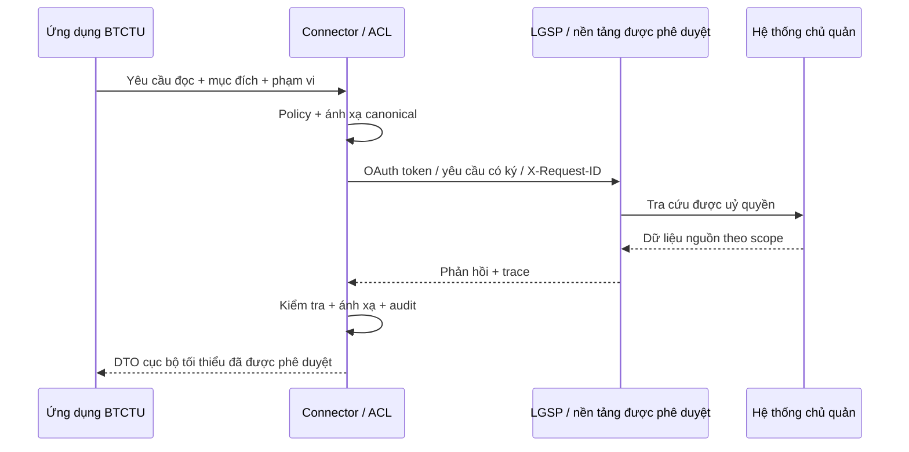

# Tích hợp trạng thái tương lai

## Nguồn

- QĐ308 — thuật ngữ/metadata/SOR canonical.
- QĐ607 — contract API cụ thể: OAuth 2.0 `client_credentials`/JWT và dữ liệu theo scope.
- QĐ348 — mức chia sẻ, mục đích/phạm vi/phê duyệt và nguyên tắc nguồn chủ quản.
- HD07 — quy trình tích hợp LGSP, X-Request-ID/chữ ký, test→prod, vòng đời/bảo mật API.
- NĐ278 — quản trị chia sẻ dữ liệu bắt buộc ở phạm vi rộng hơn.

## Kiến trúc đề xuất [INFERENCE]



## Adapter phát triển (mock)

Dùng một connector giả hiện thực cùng port:

```text
PersonnelDirectoryPort
  getPerson(externalId)
  listPeopleByDepartment(departmentExternalId)
```

Adapter phát triển trả về dữ liệu có kiểm soát. Không dùng credentials/endpoint thật
ở môi trường cục bộ.

## Yêu cầu adapter sản xuất

- chọn xác thực/uỷ quyền đúng theo endpoint và contract nền tảng đã được phê duyệt;
  không coi các cơ chế mà QĐ607 và HD07 liệt kê là thay thế lẫn nhau;
- với API theo QĐ607: OAuth 2.0 `client_credentials`, Consumer Key/Secret, JWT access
  token và Bearer authorization;
- với kết nối LGSP: chỉ hiện thực cơ chế/profile HD07 đã được phê duyệt (có thể gồm
  OAuth 2.1, OIDC 2.0, SAML2, JWT Federation hoặc mTLS);
- correlation/request ID; `X-Request-ID` cho luồng LGSP;
- chữ ký/chứng chỉ khi áp dụng;
- sổ đăng ký phiên bản schema/API;
- xử lý 401/403/hết hạn token;
- HTTPS với TLS 1.2 trở lên cho contract QĐ607;
- không bao giờ đặt dữ liệu cá nhân vào query string;
- không bao giờ ghi log access token, mật khẩu hoặc dữ liệu cá nhân;
- allowlist phạm vi/mục đích;
- sổ đăng ký ánh xạ khớp QĐ308;
- hàng đợi đối soát/lỗi và audit;
- rate limit/retry không tạo vòng lặp retry mất kiểm soát;
- môi trường test trước production;
- luân chuyển và thu hồi credential.

## SOURCE DIVERGENCE — contract xác thực

QĐ607 quy định **OAuth 2.0 `client_credentials`** cho contract API cụ thể của nó.
HD07 mô tả một tầng xác thực/tích hợp LGSP rộng hơn hỗ trợ **OAuth 2.1, OIDC 2.0,
SAML2, JWT Federation và mTLS**, cùng Bearer authorization và các kiểm soát
truy vết yêu cầu/chữ ký áp dụng.

Các phát biểu này không được gộp thành một quy tắc “OAuth2” chung. Chúng mô tả các
tầng contract khác nhau và không được mặc định là thay thế lẫn nhau. Connector sản
xuất phải theo đúng phiên bản, profile và cơ chế được phê duyệt cho endpoint/nền
tảng của nó.

## Vòng đời API

HD07 nêu các thay đổi API mang tính cấu trúc dùng versioning và phiên bản cũ được
duy trì song song trong một giai đoạn chuyển tiếp (nguồn quy định tối thiểu 180
ngày). Do đó code connector phải chịu được các phiên bản contract song song.

## Quyền sở hữu dữ liệu

Không sao chép dữ liệu nhân sự/tổ chức chủ quản như thể sở hữu cục bộ. Cũng không
gán một nguồn cho toàn bộ aggregate `Person` theo mặc định: nguồn chủ quản có thể
khác nhau theo từng trường hoặc tập dữ liệu.

Do đó projection cục bộ nên mang xuất xứ ở mức trường/tập dữ liệu, ví dụ:

`field/dataset, sourceSystem, externalId, syncedAt/sourceVersion, mappingVersion`.

Ứng dụng cục bộ sở hữu các bản ghi nhiệm vụ/đánh giá mà nó tạo; dữ liệu master từ
ngoài vẫn thuộc nguồn chủ quản.

## Cổng

Tích hợp thật vẫn TẮT cho tới khi:

- kết nối/mục đích/phạm vi được phê duyệt;
- xác nhận tập API con chính xác;
- mạng/chứng chỉ/credentials được cấp qua cơ chế được phê duyệt;
- vượt qua rà soát ATTT/phân loại dữ liệu.
