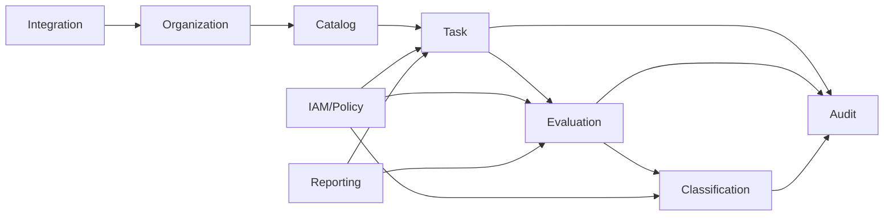

# Ranh giới module — modular monolith

| Module                   | Sở hữu                                                                             | Nguồn chính                                  |
| ------------------------ | ---------------------------------------------------------------------------------- | -------------------------------------------- |
| Organization             | tổ chức, đơn vị, projection nhân sự, membership, tham chiếu vị trí                 | QĐ01 + nguyên tắc dữ liệu chủ quản của QĐ342 |
| Responsibility & Catalog | trách nhiệm, phiên bản/mục danh mục                                                | QĐ01 + 05-HD PL1 + Excel                     |
| Task                     | nhiệm vụ, phân công, kết quả, tham chiếu sản phẩm/minh chứng, snapshot chỉ số      | QĐ01 + 05-HD                                 |
| Evaluation               | kỳ, snapshot 30/70, lần tính, hành động đánh giá                                   | 05-HD + QĐ39                                 |
| Classification           | quy tắc ngưỡng/điều kiện theo phiên bản, kiểm tra điều kiện, đề xuất xếp loại cuối | QĐ39                                         |
| IAM / Policy             | liên kết định danh, vai trò, cấp quyền, phạm vi dữ liệu, quyết định chính sách     | QĐ342                                        |
| Audit                    | sự kiện truy cập/hành động, truy vết bảo mật/nghiệp vụ                             | QĐ342 + các nguồn dữ liệu/bảo mật            |
| Reporting                | read model dashboard/báo cáo/xuất                                                  | đề bài + chỉ dữ liệu đã phê duyệt            |
| Integration              | connector, ánh xạ canonical, đồng bộ/đối soát                                      | QĐ308/607 + QĐ348 + HD07                     |
| Configuration            | tham chiếu nguồn, phiên bản quy tắc, feature gate                                  | lựa chọn thiết kế để truy vết                |

## Hướng phụ thuộc

## Quy tắc

Module không trực tiếp thay đổi bảng của module khác. Việc phối hợp diễn ra qua
application service và sự kiện domain/application bên trong một đơn vị triển khai.

Bài kiểm tra không yêu cầu microservices. Ranh giới được duy trì để về sau mới có
thể tách ra nếu quy mô/tích hợp đòi hỏi.

## Ánh xạ vào mã nguồn

ADR-011 chốt `apps/api` là một ứng dụng Express, và `createApp` chỉ làm việc ghép
nối: chọn adapter theo biến môi trường, lắp middleware chung, mount module. Nghiệp
vụ nằm trong `apps/api/src/modules`, mỗi module tự khai báo router của mình.

| Module                   | Nơi cài đặt                                                                                       | Endpoint đang có                                                                                                              |
| ------------------------ | ------------------------------------------------------------------------------------------------- | ----------------------------------------------------------------------------------------------------------------------------- |
| Organization             | `modules/organization`                                                                            | `GET /organizations`                                                                                                          |
| Responsibility & Catalog | `modules/catalog`                                                                                 | `GET /catalog`                                                                                                                |
| Task                     | `modules/task`                                                                                    | `GET /tasks`, `POST /tasks`, `GET /tasks/{id}`, `POST /tasks/{id}/result`, `/accept`, `/return`                               |
| Evaluation               | `modules/evaluation`                                                                              | `GET /evaluations`, `GET /evaluations/{id}`, `POST /evaluations/{id}/self`, `/review`, `/decision`, `POST /periods/{id}/lock` |
| IAM / Policy             | `modules/auth`, `modules/identity`, `middleware/authentication.ts`, `middleware/authorization.ts` | `/api/v1/auth/*`, `GET /me`                                                                                                   |
| Audit                    | `modules/audit`                                                                                   | `GET /audit`; phần repository/service ghi cơ sở dữ liệu đã có nhưng route còn dùng vết trong bộ nhớ của request               |
| Reporting                | `modules/reporting`                                                                               | `GET /reports/summary`                                                                                                        |

Classification, Integration và Configuration chưa có thư mục riêng.

Phần dùng chung nằm ngoài module: `middleware/` (request id, CORS, kiểm Origin,
kiểm body, xử lý lỗi), `security/` (cookie, hạn mức đăng nhập, kiểm Origin),
`shared/` (khuôn lỗi problem+json, tiện ích), `contract/openapi.ts` (bản mô tả hợp
đồng) và `db/` (schema Drizzle).

Quy ước: router không tự đọc token hay header danh tính. Middleware danh tính dựng
`req.state` và `req.actor` một lần cho cả request, mọi module phía sau dùng lại.
