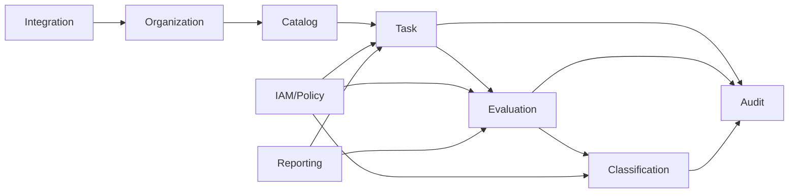

# Ranh giới module — modular monolith

| Module | Sở hữu | Nguồn chính |
|---|---|---|
| Organization | tổ chức, đơn vị, projection nhân sự, membership, tham chiếu vị trí | QĐ01 + nguyên tắc dữ liệu chủ quản của QĐ342 |
| Responsibility & Catalog | trách nhiệm, phiên bản/mục danh mục | QĐ01 + 05-HD PL1 + Excel |
| Task | nhiệm vụ, phân công, kết quả, tham chiếu sản phẩm/minh chứng, snapshot chỉ số | QĐ01 + 05-HD |
| Evaluation | kỳ, snapshot 30/70, lần tính, hành động đánh giá | 05-HD + QĐ39 |
| Classification | quy tắc ngưỡng/điều kiện theo phiên bản, kiểm tra điều kiện, đề xuất xếp loại cuối | QĐ39 |
| IAM / Policy | liên kết định danh, vai trò, cấp quyền, phạm vi dữ liệu, quyết định chính sách | QĐ342 |
| Audit | sự kiện truy cập/hành động, truy vết bảo mật/nghiệp vụ | QĐ342 + các nguồn dữ liệu/bảo mật |
| Reporting | read model dashboard/báo cáo/xuất | đề bài + chỉ dữ liệu đã phê duyệt |
| Integration | connector, ánh xạ canonical, đồng bộ/đối soát | QĐ308/607 + QĐ348 + HD07 |
| Configuration | tham chiếu nguồn, phiên bản quy tắc, feature gate | lựa chọn thiết kế để truy vết |

## Hướng phụ thuộc

## Quy tắc

Module không trực tiếp thay đổi bảng của module khác. Việc phối hợp diễn ra qua
application service và sự kiện domain/application bên trong một đơn vị triển khai.

Bài kiểm tra không yêu cầu microservices. Ranh giới được duy trì để về sau mới có
thể tách ra nếu quy mô/tích hợp đòi hỏi.
