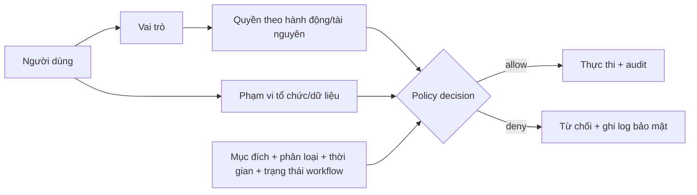

# Mô hình quyền và phạm vi dữ liệu

## Ràng buộc từ nguồn [FACT]

QĐ342 Điều 16 yêu cầu uỷ quyền dựa trên:

- vai trò;
- nhiệm vụ;
- phạm vi dữ liệu;
- mức bí mật/phân loại;
- thời hạn sử dụng;
- least privilege / đúng người / đúng việc / đúng thời điểm / đúng mục đích.

Một người dùng có thể có nhiều vai trò. Quyền cần được rà soát/thu hồi khi công
việc/thẩm quyền thay đổi. Truy cập, trích xuất, cập nhật, phê duyệt, chia sẻ và xử
lý đều phải được ghi log.

QĐ348 tiếp tục ràng buộc việc chia sẻ dữ liệu theo mục đích, bên nhận, phạm vi và
mức chia sẻ được phê duyệt.

## Mô hình chính sách đề xuất [INFERENCE]



### Đầu vào policy

```text
principal:
  userId
  roles[]
  memberships[]
  grants[]

request:
  action
  resourceType/id
  organizationScope
  dataClassification
  purpose
  workflowState
  timestamp
```

## Vai trò đề xuất

Các tên vai trò như `SYSTEM_ADMIN`, `STAFF`, `DEPARTMENT_HEAD`, `REVIEWER`,
`APPROVER`, `DATA_ADMIN` là **thiết kế phần mềm**, không phải danh sách do QĐ342 ban hành.

Tách biệt quan trọng:

- admin kỹ thuật **không** tự động có thẩm quyền nghiệp vụ để thay đổi KPI/xếp loại
  cuối;
- trách nhiệm phân công theo QĐ01 không chứng minh quyền phần mềm độc quyền;
- quan hệ người thẩm định/phê duyệt được xác định theo quy tắc thẩm quyền của QĐ39.

## Hành động rủi ro cao

Luôn cần quyền rõ ràng + lý do/audit:

- truy cập tập dữ liệu nhạy cảm/đặc biệt;
- xuất/in;
- thay đổi quyền;
- điều chỉnh điểm;
- quyết định cuối;
- mở lại đánh giá đã khóa;
- yêu cầu kết nối/chia sẻ dữ liệu.

## Mã vai trò trong mã nguồn

Ba mã đang dùng là `lanh_dao`, `truong_phong`, `cong_chuc`. Mỗi mã chỉ khai báo một
lần: hằng `ROLES` ở `apps/api/src/types.ts` (nguồn chân lý, kiểu `Role` suy ra từ
đó) và bản phản chiếu ở `apps/web/src/lib/types/organization.ts`. Trong API, mọi
so sánh vai trò đi qua bảng quy tắc ở `apps/api/src/middleware/authorization.ts`;
trong web, các chỗ kiểm tra quyền cũng dùng `ROLES` thay cho chuỗi trần. Nhãn hiển
thị tiếng Việt ("Lãnh đạo Ban", "Trưởng phòng", "Công chức") là văn bản trình bày,
không phải mã vai trò.

Danh sách vai trò đề xuất ở trên là thiết kế phần mềm. Ba mã này là mô hình đang
chạy của bản phát triển, chưa phải ma trận đã được phê duyệt.

## TBD

Ma trận vai trò/hành động chính thức, quy tắc uỷ quyền, nhãn phân loại dữ liệu và
nhịp rà soát truy cập đặc quyền cho triển khai cụ thể này.
