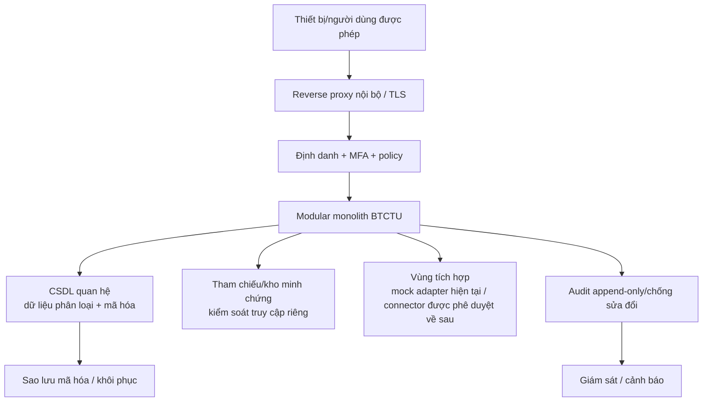

# Kiến trúc bảo mật

## Thế trận bảo mật

Ứng dụng **cố ý không** là hệ thống quản lý tài liệu bí mật nhà nước; quá trình phát
triển dùng dữ liệu seed có kiểm soát.

Thiết kế kết nối sản xuất chuẩn bị cho các kiểm soát mạnh hơn, nhưng dự án không
được tuyên bố cấp độ ATTT đã được phê duyệt chính thức cho tới khi hồ sơ/cấp thẩm
quyền xác nhận.

## Ràng buộc từ nguồn

- QĐ342: MFA cho tài khoản đặc quyền/nhạy cảm; ghi log/truy vết; phân tách mạng; mã hóa, sao lưu, xử lý sự cố.
- QĐ348/HD07: hệ thống tham gia kết nối dữ liệu Đảng phải đáp ứng quy trình kết nối/bảo mật và mục tiêu ATTT từ cấp 3.
- NĐ85: cấp độ được xác định theo thông tin/chức năng/tác động thực tế; xử lý bí mật nhà nước là tiêu chí cấp 3.
- NĐ63: tài liệu bí mật nhà nước điện tử có quy trình thiết bị/mạng xử lý riêng.
- NĐ165: lịch sử truy cập, mã hóa và vòng đời dữ liệu.
- NĐ278: chia sẻ dữ liệu an toàn có kiểm soát.

## Kiến trúc đề xuất [INFERENCE]

## Chuẩn kiểm soát cơ bản

### Định danh / truy cập
- MFA cho sử dụng đặc quyền/nhạy cảm.
- deny-by-default.
- vai trò + phạm vi + mục đích + phân loại + trạng thái.
- hết hạn/thu hồi phiên.
- rà soát truy cập định kỳ.

### Ứng dụng
- xác thực/kiểm tra quyền phía server.
- kiểm soát CSRF/phiên/secure header.
- xử lý file an toàn, kiểm tra loại/kích thước và quét malware nếu có upload.
- không để secrets trong repo/client.
- giới hạn tần suất cho thao tác nhạy cảm/xuất.

### Dữ liệu
- mã hóa khi truyền và khi lưu trữ.
- quản lý key/secret tách biệt.
- giảm thiểu dữ liệu nhạy cảm.
- audit bất biến/chống sửa đổi.
- diễn tập sao lưu + khôi phục.

### Mạng/vận hành
- vùng quản trị tách khỏi truy cập người dùng thường.
- quét patch/lỗ hổng/phụ thuộc.
- runbook xử lý sự cố.
- phân tách môi trường: dev/test/prod.
- dữ liệu kiểm thử/phát triển có kiểm soát.

## Ranh giới bí mật nhà nước

Hệ thống này không lưu nội dung bí mật nhà nước thật.

Nếu sản xuất buộc phải xử lý, kiến trúc phải được rà soát lại theo NĐ63 và các kiểm
soát mạng/thiết bị/DMS được phê duyệt. Tham chiếu metadata tới một hệ thống tài liệu
được phê duyệt tốt hơn việc sao chép tài liệu bí mật vào ứng dụng này.

## Ranh giới AI

Nếu việc soạn thảo báo cáo dùng AI:

- phát triển chỉ dùng đầu vào không nhạy cảm có kiểm soát;
- sản xuất yêu cầu môi trường AI được phê duyệt;
- kết quả AI chỉ là dự thảo/hỗ trợ và phải được con người rà soát;
- ghi log việc dùng AI theo chính sách áp dụng.
