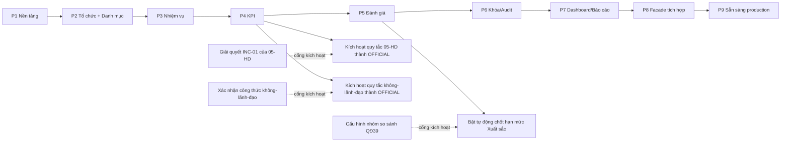

# Kế hoạch triển khai — bàn giao đầu-cuối

Quyết định triển khai liên quan:

- [Stack kỹ thuật](technical-stack.md)
- [Kế hoạch code](code-plan.md)

## Mục tiêu

Bàn giao một bản nghiệm thu chứng minh:

```text
văn bản nguồn
→ quy tắc nghiệp vụ
→ mô hình domain
→ triển khai
→ audit/quyết định hiển thị được
```

Hệ thống chỉ thay thế phần nhiệm vụ/KPI/đánh giá của HTTT TCXDĐ, không thay toàn bộ
hệ thống. Do đó phạm vi cố ý hẹp và truy vết được.

## Quy trình đầu-cuối

```text
Organization / Position / Person
        ↓
Danh mục công việc theo phiên bản
        ↓
Phân công nhiệm vụ
        ↓
Kết quả / Sản phẩm / EvidenceRef
        ↓
Tính KPI
        ↓
Tự đánh giá
        ↓
Thẩm định / nhận xét
        ↓
Điều kiện xếp loại
        ↓
Quyết định cuối
        ↓
Khóa + Audit
        ↓
Dashboard / Báo cáo
```

## Kế hoạch theo giai đoạn

### P0 — Nền tảng bằng chứng — XONG cho nhánh thiết kế

Sản phẩm:

- sổ đăng ký nguồn;
- phân tích nguồn cho QĐ01, 05-HD, QĐ39, QĐ342, QĐ348, QĐ308, QĐ607, HD07, NĐ85/63/165/278, NQ11;
- phân tích Excel vận hành;
- quy ước FACT / INFERENCE / TBD;
- sổ đăng ký bất nhất nguồn.

Cổng ra:

- mọi quy tắc nghiệp vụ cốt lõi có tham chiếu nguồn hoặc nhãn TBD/thiết kế rõ ràng.

### P1 — Nền tảng ứng dụng

**Stack đã chọn:** ứng dụng web nội bộ, Next.js + TypeScript + CSDL quan hệ; modular monolith.

Bàn giao:

- khung dự án;
- migration DB;
- dữ liệu seed phát triển;
- stub auth/session;
- interface policy tập trung;
- API audit-event;
- CI: lint/typecheck/unit test.

Chưa xây SSO/LGSP thật.

### P2 — Tổ chức + danh mục

Triển khai:

- Organization / Department;
- projection nhân sự / Membership / PositionReference;
- danh mục trách nhiệm;
- WorkCatalogVersion / WorkCatalogItem;
- màn hình admin/import staging cho Excel danh mục công việc được cung cấp.

Quy tắc:

- workbook nhập vào bắt đầu ở trạng thái DRAFT;
- công bố phiên bản một cách rõ ràng;
- nhiệm vụ lịch sử giữ nguyên phiên bản danh mục;
- không tuyên bố điểm Excel là chính thức cho tới khi được phê duyệt.

Mốc nghiệm thu:

> người rà soát truy vết được một mục danh mục về nguồn/workbook và thấy được trạng thái phiên bản/hiệu lực.

### P3 — Thực hiện nhiệm vụ

Triển khai:

- tạo nhiệm vụ từ danh mục;
- phân công/phân công lại trong phạm vi cho phép;
- inbox công chức;
- tiến độ/kết quả;
- khối lượng thực tế/thời điểm hoàn thành;
- sản phẩm + metadata EvidenceRef;
- nhận xét nghiệm thu/trả lại;
- audit đầy đủ cho phân công/kết quả.

Căn cứ nguồn: QĐ01 + 05-HD + QĐ308.

Giữ tên trạng thái nhiệm vụ được ghi nhãn rõ là thiết kế sản phẩm.

### P4 — Engine KPI

Triển khai phép tính tất định theo phiên bản:

- khối tiêu chí chung (tối đa 30);
- khối kết quả công việc (tối đa 70);
- snapshot chỉ số A/B/C/D **cho kịch bản lãnh đạo**;
- CalculationRun kèm snapshot quy tắc/đầu vào;
- UI giải thích điểm.

Kiểm thử bắt buộc:

- giá trị biên;
- thiếu chỉ số;
- chính sách làm tròn;
- phiên bản quy tắc lịch sử;
- ví dụ nguồn.

INC-01 **không chặn triển khai P4**. Xây engine tổng quát, `ScoringRuleVersion`,
snapshot đầu vào/quy tắc, UI giải thích và kiểm thử bằng một quy tắc có
`status = CANDIDATE`.

INC-01 chỉ chặn việc kích hoạt/công bố quy tắc bị ảnh hưởng dưới trạng thái
`OFFICIAL/ACTIVE`. Cho tới khi được xác nhận, hiển thị cờ “sai khác ví dụ / quy tắc
ứng viên” rõ ràng trong cấu hình phát triển.

Với công chức không giữ chức vụ lãnh đạo, dùng quy tắc ứng viên/được cấu hình riêng;
không bao giờ gắn nhãn chính thức trừ khi nghiệp vụ xác nhận.

### P5 — Đánh giá + xếp loại

Triển khai:

- tự đánh giá;
- người thẩm định nhận xét/đề xuất;
- quyết định cuối của cấp có thẩm quyền;
- dải điểm QĐ39;
- kiểm tra điều kiện bắt buộc/yếu tố chặn;
- giải thích xếp loại: “vì sao xếp lớp này”;
- loại đối tượng cá nhân và đơn vị.

**Không** tự động hóa chốt hạn mức Xuất sắc cho tới khi nhóm so sánh chính xác được
cấu hình.

### P6 — Khóa / mở lại / audit

Triển khai:

- chốt/khóa kỳ;
- từ chối chỉnh sửa sau khi khóa;
- yêu cầu mở lại có lý do được uỷ quyền;
- giữ lần chạy/quyết định cũ;
- thêm vết audit;
- luồng nghiệm thu bị từ chối quyền.

Thẩm quyền mở lại chính xác là quyết định thiết kế cục bộ/TBD, nên phát triển dùng
một vai trò có kiểm soát với nhãn rõ ràng.

### P7 — Dashboard + báo cáo/mẫu dự thảo

Triển khai:

- tổng quan cá nhân;
- tổng quan đơn vị;
- trạng thái kỳ;
- phân bố điểm/xếp loại;
- hồ sơ chờ thẩm định/quyết định;
- link truy vết tới phiên bản nguồn/quy tắc;
- xuất báo cáo bằng dữ liệu synthetic;
- mẫu dự thảo báo cáo/quyết định.

Nếu trình bày soạn thảo bằng AI:

- chỉ dữ liệu synthetic;
- đầu ra gắn nhãn DRAFT;
- bắt buộc phê duyệt bởi con người;
- không dùng AI công khai với dữ liệu production được bảo vệ.

### P8 — Facade tích hợp

Chỉ triển khai:

- sổ đăng ký ánh xạ canonical;
- `PersonnelDirectoryPort` giả;
- adapter kiểu QĐ607 giả;
- contract-profile test với mock: hành vi OAuth 2.0 `client_credentials`/JWT của
  QĐ607 và ranh giới profile LGSP được phê duyệt riêng;
- X-Request-ID/correlation ID.

Không kết nối thật trong phạm vi kiểm thử.

### P9 — Tăng cường bảo mật / gói sẵn sàng production

Chuẩn bị, không tuyên bố hoàn thành khi chưa có thẩm quyền:

- kiểm kê/phân loại dữ liệu;
- đầu vào hồ sơ cấp độ HTTT chính thức;
- threat model;
- tích hợp MFA cho tài khoản đặc quyền;
- rà soát mạng/triển khai;
- kiểm thử sao lưu/khôi phục;
- quét lỗ hổng/phụ thuộc;
- runbook xử lý sự cố;
- quyết định ranh giới tài liệu bí mật;
- phê duyệt tích hợp thật.

## Đồ thị phụ thuộc



## Đường cắt bàn giao cho mốc phát triển

Nếu thiếu thời gian, hoàn thành **P1–P7** với một happy path và một exception path.
P8 có thể là sơ đồ + fake port. P9 vẫn là kế hoạch sẵn sàng.

### Kịch bản bắt buộc trình diễn

1. trưởng phòng giao việc;
2. công chức nộp kết quả/sản phẩm;
3. hệ thống tính điểm giải thích được;
4. người thẩm định trả lại một lần, rồi thẩm định;
5. cấp có thẩm quyền quyết định cuối;
6. kỳ khóa;
7. thao tác sửa bị từ chối và ghi audit;
8. dashboard cập nhật;
9. phiên bản nguồn/quy tắc hiển thị được.

## Non-goals rõ ràng

- microservices;
- rule DSL tổng quát;
- event sourcing;
- DMS đầy đủ;
- dữ liệu bí mật nhà nước thật;
- tích hợp LGSP thật;
- ra quyết định bằng ML/AI phức tạp.

Những điều này không cải thiện tín hiệu bàn giao đủ để biện minh cho rủi ro/độ phức tạp.
