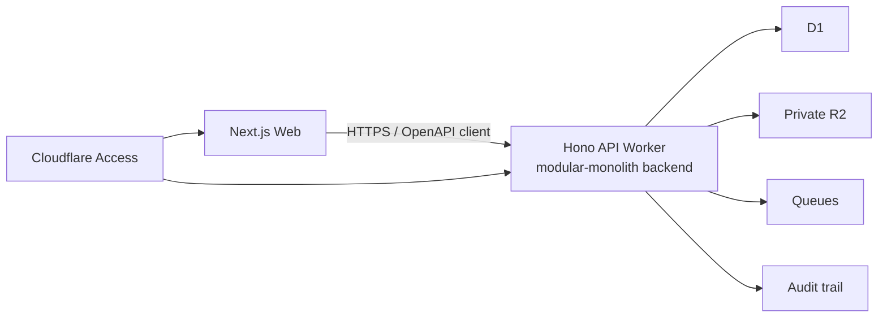

# Technical stack

## Phạm vi quyết định

Stack dưới đây là **candidate stack cho prototype/competency test**. Nó tối ưu cho
tốc độ demo, traceability và vận hành ít thành phần.

Nó **không phải quyết định production cuối cùng**. Production còn phụ thuộc vào:

- cấp độ ATTT được phê duyệt;
- phân loại dữ liệu và phạm vi bí mật nhà nước;
- hạ tầng/mạng được phép triển khai;
- yêu cầu backup/DR, data location và vận hành;
- điều kiện kết nối LGSP/HTTT TCXDĐ.

Nếu Cloudflare không được phê duyệt cho production, domain/application/API
contract vẫn được giữ và triển khai trên hạ tầng phù hợp khác.

## Quyết định cho prototype

| Layer | Chọn | Lý do |
|---|---|---|
| Frontend | Next.js App Router + TypeScript | Hệ sinh thái mạnh, phù hợp dashboard/form |
| Frontend deployment | Static/client-heavy Next.js trên Cloudflare; đánh giá vinext trước khi dùng SSR | API đã tách riêng; giảm phụ thuộc adapter runtime |
| API | Hono trên Cloudflare Workers | Nhẹ, Cloudflare-native, TypeScript-first |
| API contract | REST `/api/v1` + OpenAPI + Zod | Dễ test, demo, tích hợp và sinh client |
| Database MVP | Cloudflare D1 + Drizzle ORM | Relational, migration rõ, vận hành tối giản |
| Database production option | PostgreSQL qua Hyperdrive hoặc DB được phê duyệt trên hạ tầng khác | Chọn theo pilot/production gates |
| Evidence files | Private R2 cho synthetic/demo; production storage TBD | Tách metadata khỏi file; authorization rõ |
| Async jobs | Cloudflare Queues | Báo cáo, notification, import và hậu xử lý; consumer phải idempotent |
| Authentication edge | Cloudflare Access + IdP cho prototype/pilot nếu được phép | SSO/MFA/deny-by-default ở edge |
| Authorization app | RBAC + organization/data scope + context | Edge auth không thay thế quyền nghiệp vụ |
| Scheduled jobs | Workers Cron Triggers | Đóng kỳ, reminder, reconciliation |
| Observability | Workers Logs/Traces + structured logs | Correlation ID, lỗi và latency |
| Tests | Vitest + Cloudflare Vitest plugin + Playwright | Chạy logic/bindings trong Workers runtime và E2E trình duyệt |
| Deploy/config | Wrangler + GitHub Actions | Ít công cụ, preview/staging rõ |

## Application shape



Frontend và backend là **hai deployable units**.

“Modular monolith” trong tài liệu này chỉ **backend application structure**:
Organization, Task, Evaluation, Classification, IAM/Policy, Audit... là module
logic trong cùng một backend deployable, không phải microservice riêng.

## API: chọn Hono, không chọn Next.js Route Handlers

Lý do:

- frontend/backend deploy độc lập và API boundary rõ;
- API tương lai có thể phục vụ integration hoặc client khác;
- Hono chạy trực tiếp trên Workers và có ít abstraction không cần thiết;
- OpenAPI thể hiện contract tốt hơn tRPC trong portfolio và phù hợp future API sharing.

Không chọn:

- **NestJS:** nặng và Node-centric hơn nhu cầu của Workers/MVP;
- **Express:** không phải lựa chọn Workers-native tốt nhất;
- **tRPC:** rất tốt cho monorepo TypeScript, nhưng contract khó dùng hơn với hệ thống ngoài;
- **GraphQL:** chưa có nhu cầu query graph/federation đủ lớn;
- **microservices:** tăng vận hành mà chưa tạo giá trị cho vertical slice.

## Frontend

- Next.js App Router, TypeScript strict.
- Tailwind CSS + shadcn/ui cho design system; không chỉnh trực tiếp component vendor khi có thể bọc lại.
- TanStack Query cho server state; không đưa toàn bộ API state vào global store.
- React Hook Form + Zod cho form/schema ở client.
- TanStack Table cho task/evaluation/audit grids.
- URL giữ filter/sort/page để link và back/forward hoạt động đúng.
- Client API được sinh từ OpenAPI; không tự viết nhiều kiểu dữ liệu trùng API.

Ứng dụng là dashboard nội bộ nên SSR không phải dependency cốt lõi. Bắt đầu bằng
static/client-heavy deployment. Chỉ bật SSR/Server Actions sau compatibility spike
trên Cloudflare và khi có use case rõ.

## Backend

- Hono middleware chain: request ID → Access JWT verification → actor mapping → authorization → validation → handler → audit/metrics.
- Application services điều phối use case; domain không phụ thuộc Hono, D1 hay Cloudflare bindings.
- Drizzle schema/migrations; repository interface giúp đổi D1 sang PostgreSQL/approved DB nếu production gate yêu cầu.
- RFC 7807-style problem response, idempotency key cho mutation nhạy cảm/import/integration.
- Optimistic concurrency/version column cho approve, lock và update quan trọng.
- Audit ghi cùng use case; side effect bất đồng bộ dùng transactional-outbox pattern phù hợp khả năng DB được chọn.

## Data/storage

### D1

Dùng cho MVP vì dataset bài test nhỏ, quan hệ rõ và Cloudflare binding đơn giản.
Không bật read replication trong MVP.

Trước pilot/production phải đánh giá:

- transaction/concurrency của approval/locking;
- backup/restore và RPO/RTO;
- data location/jurisdiction;
- reporting volume;
- yêu cầu công cụ vận hành/DBA;
- việc hạ tầng này có được cấp có thẩm quyền chấp nhận hay không.

Nếu không đạt gate, chuyển sang PostgreSQL hoặc DB/hạ tầng được phê duyệt;
domain/API không đổi.

### R2

Cho prototype:

- bucket private;
- object key không chứa dữ liệu nhạy cảm;
- D1 chỉ giữ metadata, checksum, media type, size, classification và object key;
- API cấp quyền trước khi tạo URL ngắn hạn;
- giới hạn size/type, checksum, quarantine/status scan;
- chỉ dùng synthetic/demo evidence.

Production evidence storage vẫn TBD và có thể phải dùng DMS/kho lưu trữ được
phê duyệt thay vì R2.

### KV

Chỉ dùng nếu cần cache cấu hình không nhạy cảm/danh mục đọc nhiều. Không dùng
KV làm nguồn thật cho permission, workflow, điểm hoặc audit.

### Queues

Các job: tạo báo cáo, import master data, notification và integration retry.
Consumer bắt buộc dùng idempotency key/deduplication.

## Authentication và authorization

Prototype/pilot candidate:

1. Cloudflare Access bảo vệ web/API và liên kết IdP.
2. API xác minh JWT Access gồm signature, issuer và audience.
3. Email/subject map sang `UserIdentity`.
4. Policy engine nội bộ kiểm tra `action + resource + scope + context`.
5. Không tin role do frontend gửi lên.

Production identity/MFA mechanism phải được xác nhận theo hạ tầng được phê duyệt.

Local development dùng signed test identity hoặc dev-only auth adapter; adapter này
không được build/deploy vào production.

## Monorepo

```text
apps/
  web/                 Next.js
  api/                 Hono Worker / backend adapter
packages/
  contracts/           OpenAPI schemas + generated client
  domain/              entities, value objects, policies
  db/                  schema, migrations, repositories
  auth/                identity and authorization contracts
  observability/       logger, trace, audit envelope
  config/              shared TypeScript/ESLint config
tools/
  excel-import/        Node CLI: Excel -> validated staging JSON
```

`pnpm` workspace là đủ; chưa cần Turborepo. Excel được parse bằng Node CLI ở
bước quản trị/offline, không parse workbook lớn trong request Worker. CLI tạo
manifest/checksum/validation report rồi API import staging JSON.

## Quality toolchain

- TypeScript strict, ESLint, Prettier.
- Vitest cho domain/application; Cloudflare Vitest plugin cho bindings.
- Playwright cho happy path, return-for-correction và permission denied.
- OpenAPI contract tests; migration test trên DB sạch.
- GitHub Actions: install → lint → typecheck → unit → integration → build → E2E preview.
- dependency audit và secret scanning.

## Môi trường

| Environment | Data | Deployment |
|---|---|---|
| Local | synthetic fixtures | local bindings/Miniflare |
| Preview PR | synthetic, resettable | Cloudflare preview resources |
| Staging/demo | synthetic/approved masked only if allowed | isolated prototype resources |
| Production | real data only after formal approval | **TBD — approved infrastructure required** |

Không dùng chung database/bucket/secrets giữa staging và production.
